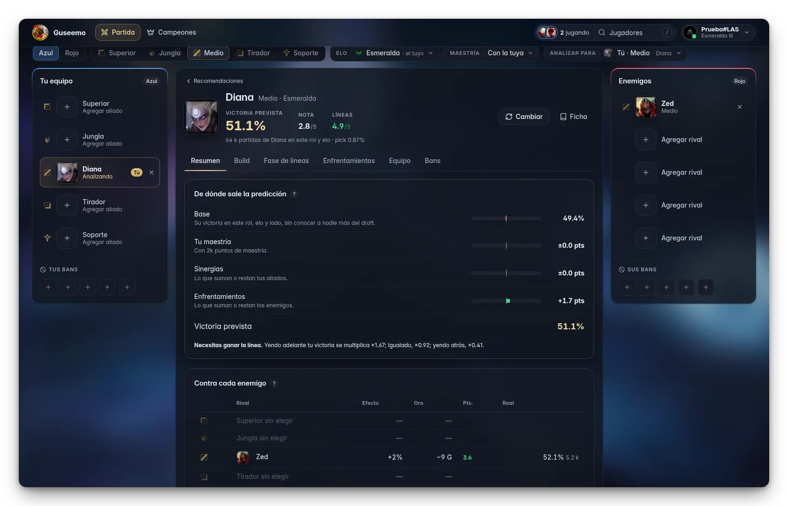
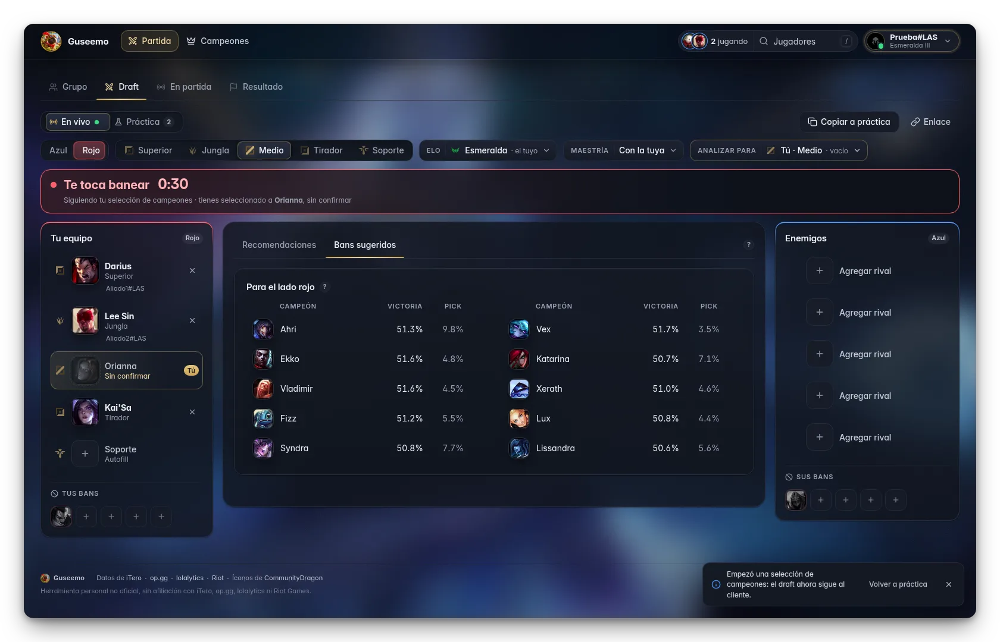
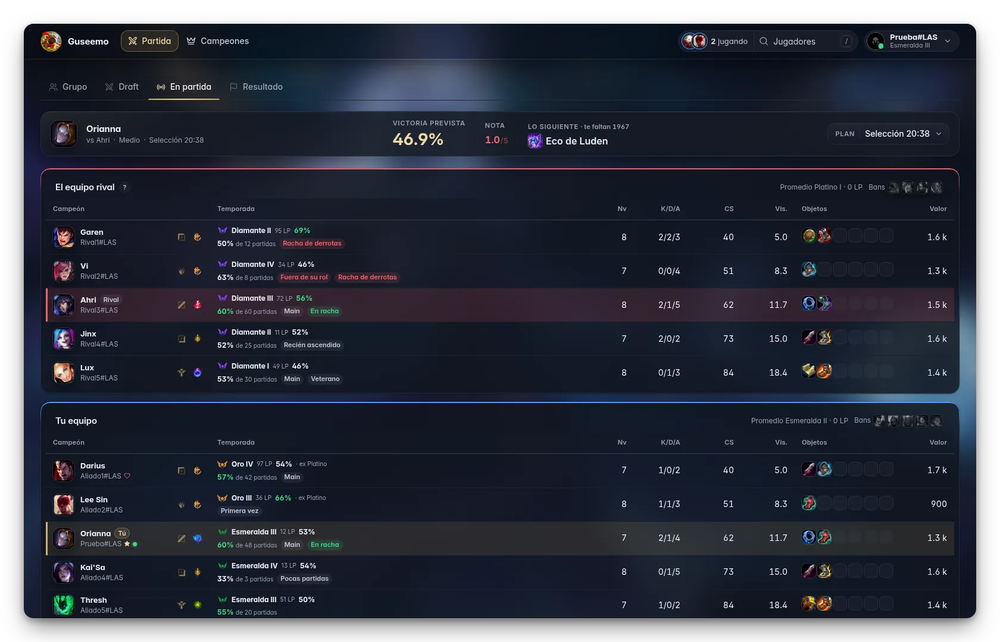
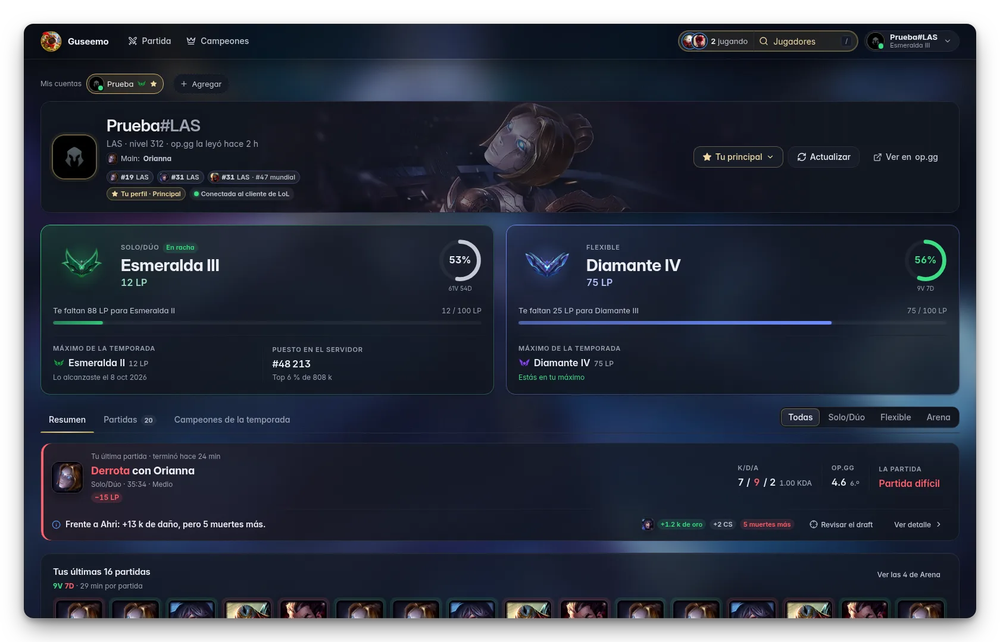
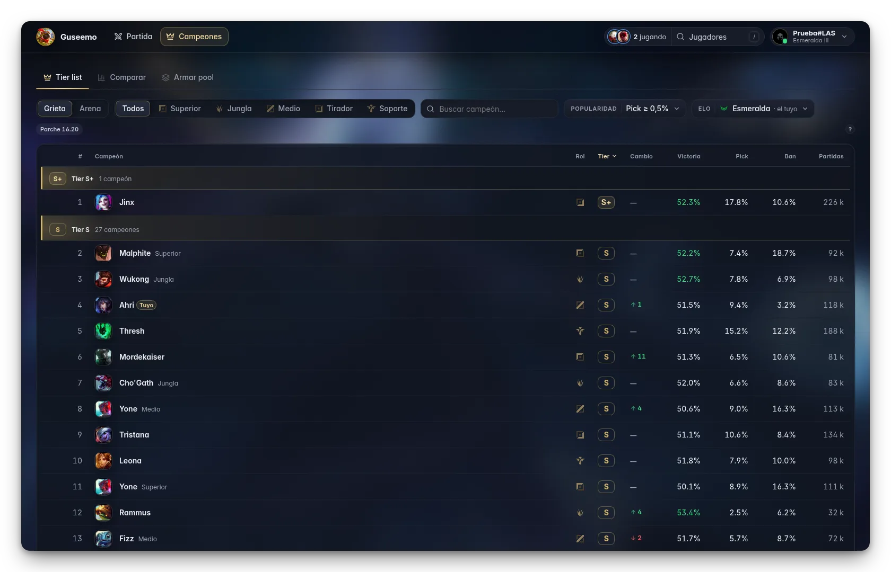
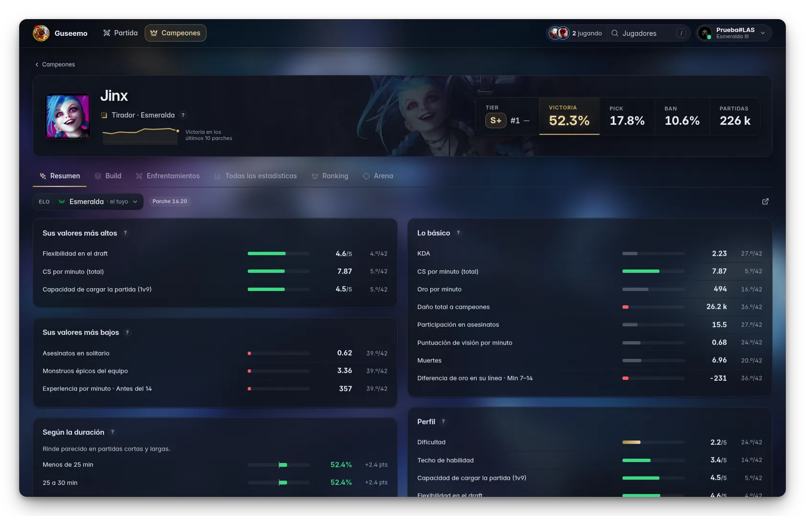

<div align="center">


# Guseemo

**Tu compañero de League of Legends para Windows.**<br>
El draft, la partida y lo que viene después, en una sola ventana al lado del juego.

<br>

[](https://github.com/sbtcontreras/guseemo-releases/releases/latest/download/Guseemo.zip)

[](https://github.com/sbtcontreras/guseemo-releases/releases/latest)
[](https://github.com/sbtcontreras/guseemo-releases/releases/latest)


<sub>5 MB · sin instalar · se actualiza sola</sub>

<br>



</div>

<br>

## Una ventana para cada momento

Guseemo sigue al cliente de LoL y cambia de vista sola: no hay que buscar nada mientras eliges, juegas o miras cómo te
fue. Del cliente y de la partida **solo lee, nunca escribe**: no elige, no banea, no importa runas ni objetos.

<table>
  <tr>
    <td width="33%" valign="top">
      <h3>🛡️ Antes</h3>
      Tu grupo con la liga de cada uno y, en la selección, recomendaciones para tu hueco y tus bans, la victoria
      prevista con su desglose, builds pensadas para ese draft y cómo se juega tu línea minuto a minuto.
    </td>
    <td width="33%" valign="top">
      <h3>⚔️ Durante</h3>
      Tu plan en la partida: lo siguiente de tu build según tu oro, tu línea frente a lo esperado, consejos contra tu
      rival y el marcador de los diez con su rango y cómo le va a cada uno con su campeón.
    </td>
    <td width="33%" valign="top">
      <h3>🏆 Después</h3>
      Victoria o derrota sobre el arte de tu skin, tus LP y tu partida en cinco números, con lo que aportaste a tu
      equipo y lo más destacado. Y desde tu historial, <b>Revisar el draft</b> de cualquier partida.
    </td>
  </tr>
</table>

<br>

### En el draft

Recomendaciones para tu hueco ordenables por victoria prevista, fase de líneas, daño parejo o mejor final de partida,
solo entre tus campeones si quieres. Con el cliente abierto, lo que no tienes queda atenuado y te avisa cuándo te
toca; con **Práctica**, armas cualquier draft a mano y lo compartes con un enlace.



- **Victoria prevista** con de dónde sale: tu maestría, tus aliados y cada enemigo, y lo que necesitas de la línea.
- **Build para ese draft**, con tus runas y hechizos frente a la opción más parecida, al día mientras los cambias.
- **Cómo jugar contra tu rival** según Riot: sus habilidades con el enfriamiento por nivel y sus consejos.
- **En la jungla**, tu ruta en el minimapa con los seis campamentos en orden, y dónde suele empezar el jungla rival.
- **En Arena**, su propia vista: qué elegir con tus compañeros y tu build al confirmar.

### En partida

Lo que el TAB no te dice. Sin repetir lo que ya ves dentro del juego: reloj, oro y temporizadores siguen allá.



- **Tu plan del draft** a la vista: tu duelo, la victoria prevista y qué comprar con el oro que tienes.
- **El marcador con contexto**: rango y LP de cada uno, cómo le va con su campeón, y avisos como *Racha de derrotas*,
  *Autofill* o *Fuera de su rol*.
- **Tus números** que el juego no calcula: CS por minuto, participación y visión por minuto.
- **En Arena**: qué aumento u objeto prismático rinde más con tu campeón, con buscador para los tres que te ofrecen.

### Jugadores

Tú, tus amigos y cualquier jugador, a un atajo de distancia (<kbd>/</kbd>). Tus amigos del cliente aparecen con lo que
están haciendo ahora.



- Rango y LP en solo/dúo y flexible, cuánto te falta para subir y tu máximo de la temporada.
- Tu última partida frente a tu rival de línea, la forma reciente y un resumen de tus partidas.
- El historial con los diez jugadores de cada partida y tus campeones de toda la temporada.
- Su puesto en el ranking de sus campeones, si está entre los 50 mejores de su región.

### Campeones

Para informarte cuando quieras, sin ninguna partida en curso.

<table>
  <tr>
    <td width="50%"></td>
    <td width="50%"></td>
  </tr>
  <tr>
    <td valign="top"><b>Tier list</b> de la Grieta por elo y rol, o de Arena por región, con cuántos puestos subió o
    bajó cada campeón desde el parche anterior.</td>
    <td valign="top"><b>La ficha de cada campeón</b>: build, runas, enfrentamientos, las ~600 estadísticas de iTero,
    su ranking de jugadores y su vista de Arena.</td>
  </tr>
</table>

Y además **Comparar** campeones en las estadísticas que elijas, y **Armar pool**, paso a paso, con tu rol, tu elo y
tu maestría.

<br>

## Empezar

1. **Descarga** [`Guseemo.zip`](https://github.com/sbtcontreras/guseemo-releases/releases/latest/download/Guseemo.zip)
   y descomprímelo en cualquier carpeta.
2. **Abre** `Guseemo.exe` con doble clic. No hay que instalar nada.
3. **La primera vez**, abre el cliente de LoL con tu cuenta para comprobar que tenga acceso.

> [!NOTE]
> Windows puede mostrar **«Windows protegió su PC»** porque el programa no está firmado con un certificado pagado.
> Toca **Más información → Ejecutar de todas formas**. Es solo la primera vez.

Guseemo se abre como una ventana aparte, con su lugar en la barra de tareas: ponla en otro monitor o al lado del
cliente. Si la abres con la selección o la partida ya en curso, va directo a ella.

<br>

## Acceso por invitación

Guseemo es por invitación. Cada cuenta de LoL tiene un **código de acceso** que la app calcula sola a partir de la
cuenta del cliente; nadie lo escribe, así que pasárselo a otro no le sirve.

- Si tu cuenta no tiene acceso, la app te muestra tu código con **Copiar código**: mándaselo a quien te la pasó.
  Cuando lo agrega, se abre sola en unos minutos, sin reiniciarla.
- Después abre sin el cliente, mientras lo abras con esa cuenta al menos una vez al mes.
- Tus otras cuentas en el mismo PC no necesitan código propio.

<br>

## Hecha para confiar en ella

<table>
  <tr>
    <td width="50%" valign="top">
      <b>👁️ Solo lee</b><br>
      Usa las interfaces locales que el cliente y el juego ofrecen a las apps de terceros. No lee la memoria del
      juego, no inyecta nada y nunca actúa por ti.
    </td>
    <td width="50%" valign="top">
      <b>✍️ Actualizaciones firmadas</b><br>
      Se actualiza sola y solo instala una versión nueva si viene firmada por Guseemo: nadie puede hacer pasar otro
      programa por una actualización.
    </td>
  </tr>
  <tr>
    <td valign="top">
      <b>💾 Todo queda en tu PC</b><br>
      Tus cuentas, drafts y ajustes se guardan en <code>%LOCALAPPDATA%\Guseemo</code>. Ajustes › Acerca de abre la
      carpeta.
    </td>
    <td valign="top">
      <b>🧹 Sin instalador</b><br>
      Un solo <code>.exe</code>, sin servicios ni permisos de administrador. Para quitarla, borra su carpeta y la de
      sus datos.
    </td>
  </tr>
</table>

<details>
<summary><b>Comprobar la descarga</b></summary>
<br>

Cada versión publica el `sha256` de `Guseemo.exe`. En PowerShell, dentro de la carpeta:

```powershell
(Get-FileHash .\Guseemo.exe -Algorithm SHA256).Hash
```

Tiene que coincidir con `Guseemo.exe.sha256` de la misma [versión](https://github.com/sbtcontreras/guseemo-releases/releases/latest).

</details>

<details>
<summary><b>Requisitos</b></summary>
<br>

- Windows 10 u 11, con el motor de Edge (WebView2, que ya viene con Windows). En un Windows 10 viejo sin actualizar,
  se abre en tu navegador.
- Internet: los datos vienen de iTero, op.gg y lolalytics.
- El cliente de LoL en el mismo PC para seguir la selección y la partida; sin él, el draft se arma a mano.

</details>

<details>
<summary><b>Algo falló</b></summary>
<br>

Si la app se cierra sola o algo no responde, el detalle queda en `%LOCALAPPDATA%\Guseemo\guseemo.log`. Mándaselo a
quien te invitó.

</details>

<br>

---

<p align="center"><sub>
Datos de <a href="https://itero.gg">iTero</a>, <a href="https://op.gg">op.gg</a> y <a href="https://lolalytics.com">lolalytics</a> · íconos de <a href="https://communitydragon.org">CommunityDragon</a>
</sub></p>

<p align="center"><sub>
© 2026 sbtcontreras. Uso personal y por invitación: prohibido distribuirlo, modificarlo o saltarse su acceso sin permiso de su autor.
</sub></p>

<p align="center"><sub>
Guseemo no está respaldado por Riot Games y no refleja las opiniones de Riot Games ni de nadie que participe oficialmente en la producción o gestión de las propiedades de Riot Games. Riot Games y todas las propiedades asociadas son marcas comerciales o marcas registradas de Riot Games, Inc. Guseemo tampoco tiene afiliación con iTero, op.gg ni lolalytics.
</sub></p>
